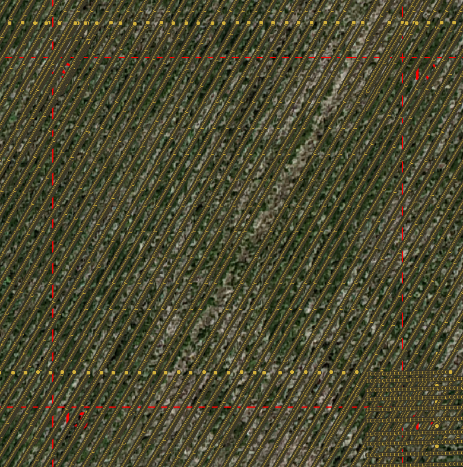

# crop-row-connector

*crop-row-connector* reconnects crop rows that were detected as separate fragments when a large orthomosaic image is processed tile-by-tile. It takes the output of [Crop Row Detector](https://github.com/henrikmidtiby/CropRowDetector), links the row fragments across tile boundaries into continuous crop rows, and classifies the vegetation along each row as healthy or unhealthy.



## Installation

The package is published on PyPI:

```
pip install crop-row-connector
```

To install from source instead, clone the repository and use [uv](https://docs.astral.sh/uv/) (a Rust toolchain is required to compile the native extension):

```
git clone https://github.com/SDU-UAS-Center/crop-row-connector.git
cd crop-row-connector
uv sync --reinstall
```

## Quick start with the test data

The repository includes a small test dataset in `test_dataset/`:

- `test_dataset/input/row_information_global.csv` — crop row segments detected per tile.
- `test_dataset/input/points_in_rows.csv` — vegetation points along the rows.
- `test_dataset/orthomosaic_test_data.tif` — the orthomosaic the data was derived from (viewable in QGIS).

Run the connector on the test data (note that `--angle_tolerance` is measured in **degrees**):

```
crop-row-connector \
    test_dataset/input/row_information_global.csv \
    test_dataset/input/points_in_rows.csv \
    --distance_tolerance 0.12 \
    --angle_tolerance 6.9 \
    --output_path_connected_crop_rows test_dataset/output/connected_crop_rows.csv \
    --output_path_vegetation_points test_dataset/output/line_points.csv \
    --output_path_unhealthy_vegetation_segments test_dataset/output/unhealthy \
    --output_path_healthy_vegetation_segments test_dataset/output/healthy
```

The output files are written to the paths given on the command line and can be visualized with georeferencing tools such as QGIS. See the [tutorial](https://sdu-uas-center.github.io/crop-row-connector/) for a walkthrough including the expected output.

## Documentation

The full documentation — tutorials, how-to guides, algorithm explanation, and API reference — is hosted at <https://sdu-uas-center.github.io/crop-row-connector/>.

## Acknowledgement

The *crop-row-connector* tool was developed by SDU UAS Center as part of the project *Præcisionsfrøavl*, supported by the [Green Development and Demonstration Programme (GUDP)](https://gudp.lbst.dk/) and [Frøafgiftsfonden](https://froeafgiftsfonden.dk/), both from Denmark.
