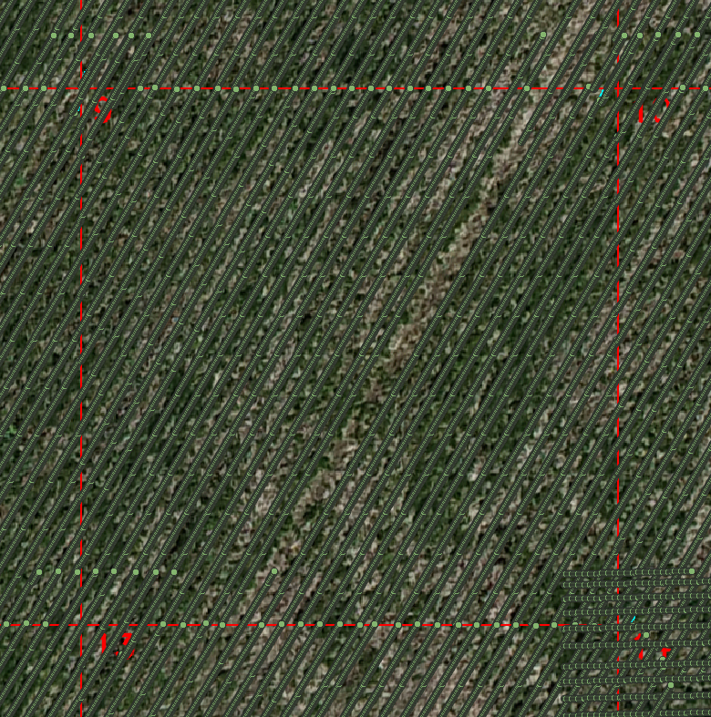
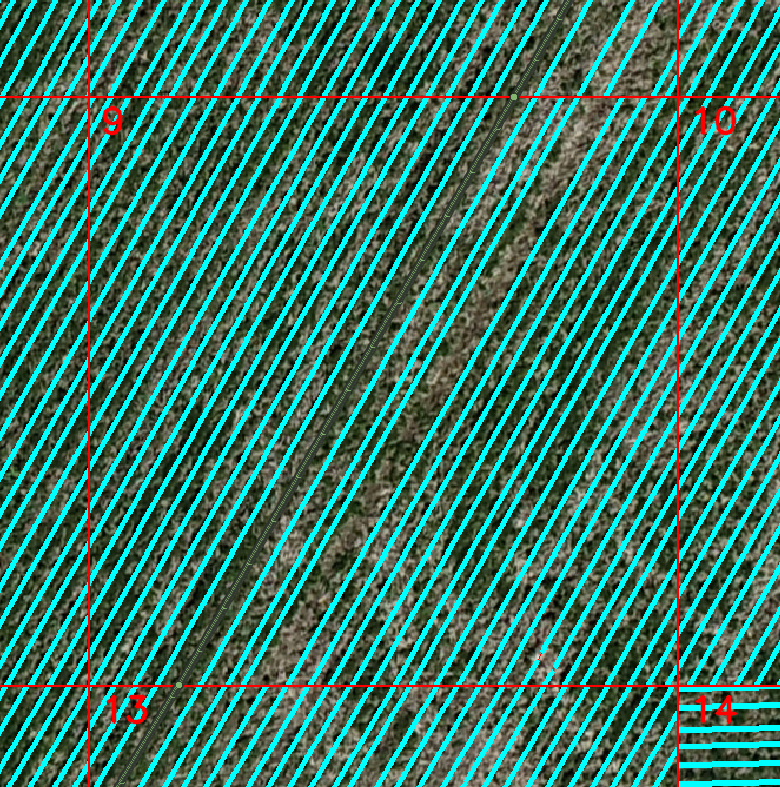

.. _tutorial-test-data:

Tutorial with Test Data
=======================

In this tutorial, we run *crop-row-connector* on the test dataset included in the repository and walk through the output it produces.

The Test Dataset
-----------------

The dataset is found in the ``test_dataset/`` directory at the root of the repository:

- ``test_dataset/input/row_information_global.csv`` — the detected crop row segments, one per tile.
- ``test_dataset/input/points_in_rows.csv`` — all vegetation points along the rows.
- ``test_dataset/orthomosaic_test_data.tif`` — the orthomosaic the data is derived from (can be viewed with georeferencing tools like QGIS).

A visual representation of all the points in the orthomosaic can be seen below:

.. figure:: ../_static/figures/Field_detected.png

    Detected crop rows in an orthomosaic field.

The field contains a rotation: rows in most tiles run at an angle of about 0.52 radians from the X axis, while rows in a few tiles (7, 11, 14 and 15) run at about 1.55 radians — almost perpendicular to the rest. This makes the dataset a good test of the angle tolerance.

.. note::
    All tolerances and lengths are given in the coordinate system of the input data. In the test dataset this is UTM meters.

Running the Connector
---------------------

If *crop-row-connector* is not already installed, see :doc:`installation </installation>`.

If the installation added *crop-row-connector* to your ``PATH``, run it as:

.. code-block:: shell

    crop-row-connector

Otherwise use the module form (note the underscores — module names cannot contain dashes):

.. code-block:: shell

    python -m crop_row_connector

From here on we assume *crop-row-connector* is on the ``PATH``; if not, replace ``crop-row-connector`` with ``python -m crop_row_connector`` in the commands below.

Use the following command to run the connector on the test data:

.. code-block:: shell

    crop-row-connector \
        test_dataset/input/row_information_global.csv \
        test_dataset/input/points_in_rows.csv \
        --distance_tolerance 0.12 \
        --angle_tolerance 6.9 \
        --output_path_connected_crop_rows test_dataset/output/connected_crop_rows.csv \
        --output_path_vegetation_points test_dataset/output/line_points.csv \
        --output_path_unhealthy_vegetation_segments test_dataset/output/unhealthy \
        --output_path_healthy_vegetation_segments test_dataset/output/healthy

.. note::
    ``--angle_tolerance`` is measured in **degrees** (default: 10). The value 6.9 is used here because of the rotation between tiles in the test field; for a field without rotation the default works well.

All output arguments are optional — any output you do not give a path for is simply not saved.

Understanding the Output
------------------------

**connected_crop_rows.csv** — which row segments were connected.

Each row segment appears once, with the connected crop row id it belongs to and up to four neighbours it was linked to:

.. list-table::
    :header-rows: 1

    * - row_index
      - tile
      - row
      - con_1_tile
      - con_1_row
      - con_2_tile
      - con_2_row
      - con_3_tile
      - con_3_row
      - con_4_tile
      - con_4_row
      - dubli_error
    * - 0
      - 0
      - 1
      - 4
      - 4
      - 1
      - 2
      -
      -
      -
      -
      - False
    * - 0
      - 1
      - 2
      - 0
      - 1
      -
      -
      -
      -
      -
      -
      - False
    * - 1
      - 0
      - 2
      - 1
      - 3
      -
      -
      -
      -
      -
      -
      - False

- **row_index**: id of the connected crop row (all segments of one physical row share this id)
- **tile**, **row**: the tile and row number this segment came from
- **con_N_tile**, **con_N_row**: the tile and row numbers of connected segments
- **dubli_error**: ``True`` if this segment was assigned to more than one connected crop row, which indicates a problem with the chosen tolerances

**line_points.csv** — all vegetation points, regrouped by connected crop row:

.. list-table::
    :header-rows: 1

    * - row
      - x
      - y
      - vegetation
      - duplicate
    * - 0
      - 497023.84
      - 6162180.51
      - 33
      - False
    * - 0
      - 497023.84
      - 6162180.52
      - 17
      - False
    * - 0
      - 497023.85
      - 6162180.53
      - 55
      - False

- **row**: id of the connected crop row (matches ``row_index`` above)
- **x**, **y**: point coordinates
- **vegetation**: grayscale vegetation intensity (0–255) at this point
- **duplicate**: ``True`` if the point was present in more than one row segment

**healthy / unhealthy shapefiles** — vegetation health segments as line geometries (``healthy.shp`` and ``unhealthy.shp`` plus sidecar files), with a single attribute ``Crop_row`` giving the connected crop row id. These can be opened directly in QGIS.

Expected Result
---------------

With the command above, the test data connects into 252 crop rows out of 594 detected row segments — the remaining fragments belong to the rotated part of the field, where rows stop at the rotation boundary. If you see around 577 rows instead, your ``--angle_tolerance`` is too small (for example if it is accidentally given in radians — remember it is in degrees).

The connected crop rows look like this:

    Orthomosaic with the connected crop rows.

A single connected crop row spanning multiple tiles:

    A single connected crop row.

Next Steps
----------

- :doc:`Prepare your own field data </how_to/preparing_your_data>`
- :doc:`Choose connection parameters </how_to/choose_connection_parameters>`
